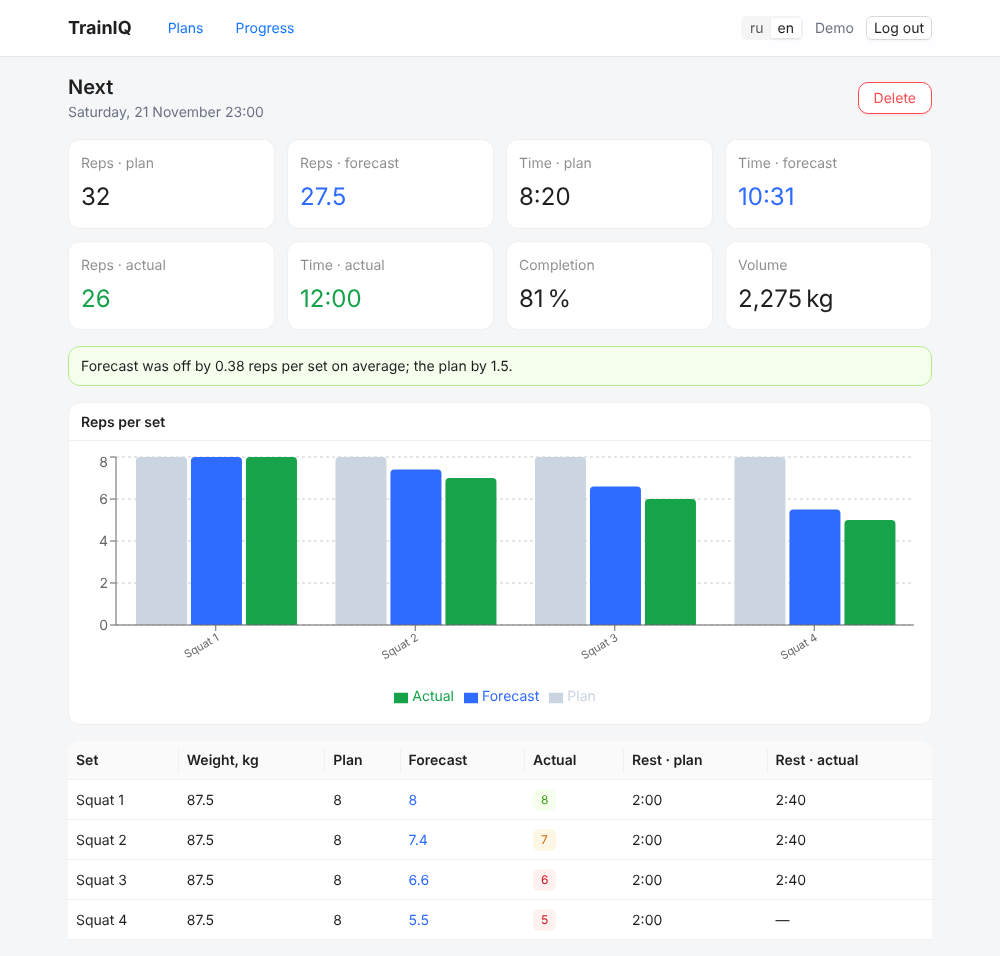

# TrainIQ

**A workout planner that learns how *you* actually train.**

You plan sets, reps, weight and rest. TrainIQ predicts what you will really do: how many reps per set, how long you'll rest, how long the session takes. After the workout it puts plan, forecast and reality side by side. Every logged workout makes the forecast more personal.

[Русская версия](README.ru.md)



## Features

- Plan workouts: exercises, sets, reps, weight, rest
- Guided workout mode with a rest timer that records your *real* rest and set duration
- Personalised forecast of reps, rest and total time for every planned set
- Plan / forecast / actual report, with a score for how accurate the forecast was
- "Suggest weight": the heaviest weight at which the model expects you to complete every set
- Estimated 1RM progress chart with a projection
- Russian and English UI, self-hosted, MIT licensed

## Quick start

```bash
git clone https://github.com/<you>/trainiq && cd trainiq
cp .env.example .env
docker compose up --build
```

Open http://localhost:8080 and sign up.

## Architecture

```
packages/
  frontend/  React + Vite + Ant Design + Tailwind + recharts + i18next
  backend/   Node + Express + TypeScript + Sequelize + PostgreSQL
  ml/        Python + FastAPI + scikit-learn
```

```
browser ──► frontend (nginx) ──/api──► backend ──► PostgreSQL
                                          │
                                          └─ history + plan ──► ml ──► forecast
```

The **ML service is stateless**. The backend owns all data and sends the user's history along with each request. The only state the ML service keeps is the trained model file. That makes it easy to scale, replace or reuse with a different backend.

## How the model works

**Target:** the number of reps you'll do in each planned set.

1. **One global model** (`HistGradientBoostingRegressor`) learns how people in general respond to load. Its features:
   - relative intensity: weight ÷ your recent estimated 1RM
   - set number, rest before the set, days since the last session, experience
2. **User profile features** turn the global model into a personal one: how many reps *you* usually lose from set to set, and what share of the plan *you* usually complete. They are exponentially weighted averages over your past sessions, so the model learns interactions like "fast-fatiguing lifter on set 4" instead of a flat offset.
3. **A shrunk personal bias** adds `Σ residuals / (n + K)` on top. It is near zero for new users and approaches their true average error as data accumulates (empirical-Bayes partial pooling).
4. **Rest and tempo** are per-user ratios pooled toward the population. Rest is averaged in log space, so resting 2× and 0.5× the plan cancel out instead of averaging to 1.25×.

**No leakage:** every feature for a session is computed only from sessions *before* it. Training and serving share one feature pipeline. The report recomputes the forecast as it looked before the workout started, so the accuracy score is honest.

**Cold start:** without a trained model, the forecast equals the plan. Training mixes in synthetic athletes, so the global model is reasonable from day one.

### Evaluation (synthetic data, 60 lifters × 12 weeks, time-based split)

| Method | MAE, reps per set |
|---|---|
| "You'll do what you planned" | 2.00 |
| Global model with profile features | 0.69 |
| + personal bias | 0.68 |

For a user the model has never seen, error drops from 1.70 on the first session to about 0.67 after 4 sessions. See [`packages/ml/notebooks/prototype.py`](packages/ml/notebooks/prototype.py); open it in VS Code or Jupyter (`# %%` cells).

## Development

Requirements: Node 22, Yarn 1, Python 3.11+, PostgreSQL 16.

```bash
yarn install
pip install -e "packages/ml[dev]"

createdb trainiq                       # or use the db service from docker compose
yarn migrate

uvicorn trainiq_ml.app:app --port 8001 --app-dir packages/ml   # terminal 1
yarn dev:backend                                                # terminal 2, :8000
yarn dev:frontend                                               # terminal 3, :5173
yarn seed                               # demo@trainiq.dev / demo123 with 6 weeks of history
```

Tests:

```bash
yarn test                              # backend (needs a trainiq_test database)
cd packages/ml && pytest               # ML
```

## Known limitations

- **Censoring.** If you can do 12 reps but planned 8, the data says 8. The model predicts completion of the plan, not your limit. RPE or AMRAP sets would fix this.
- `/api/ml/train` retrains the shared model and is open to any signed-in user. Put it behind an admin check on a public instance.
- Synthetic data proves the pipeline recovers known patterns. Real accuracy shows up in each workout report: compare the forecast error with the plan error.

## Contributing

See [CONTRIBUTING.md](CONTRIBUTING.md). Good first issues: RPE input, deload detection, export to CSV, a mobile app.

## License

[MIT](LICENSE)
